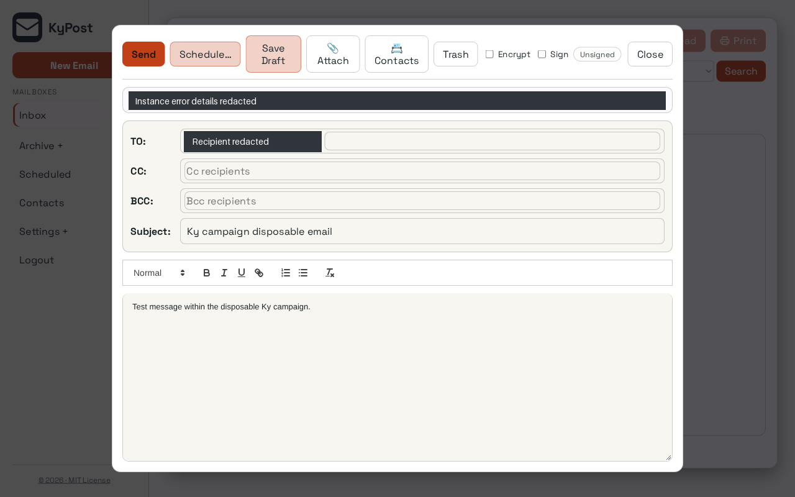
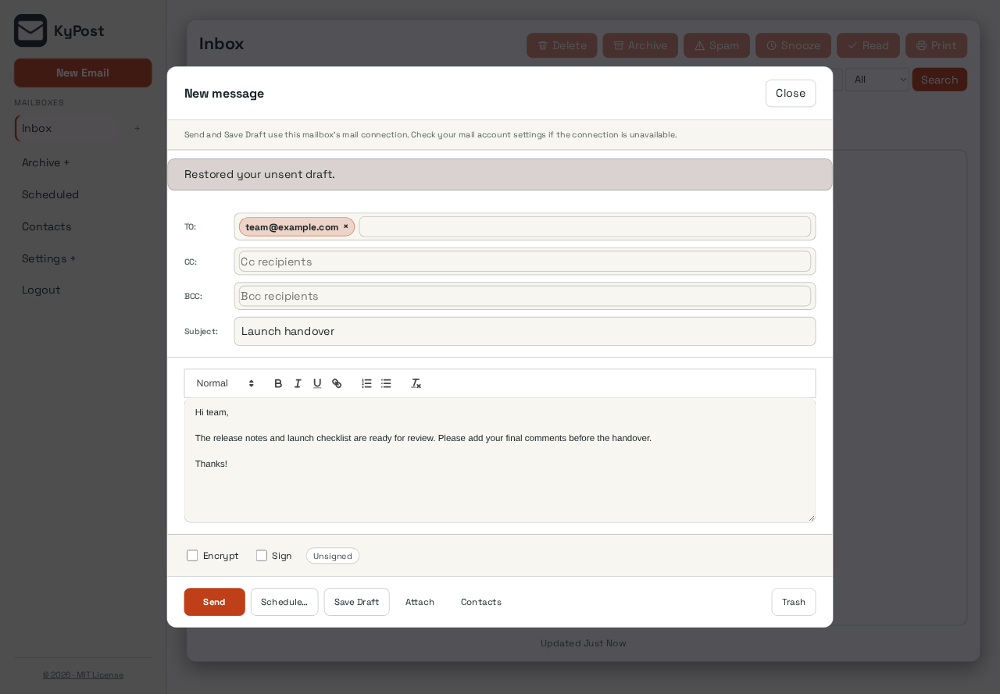
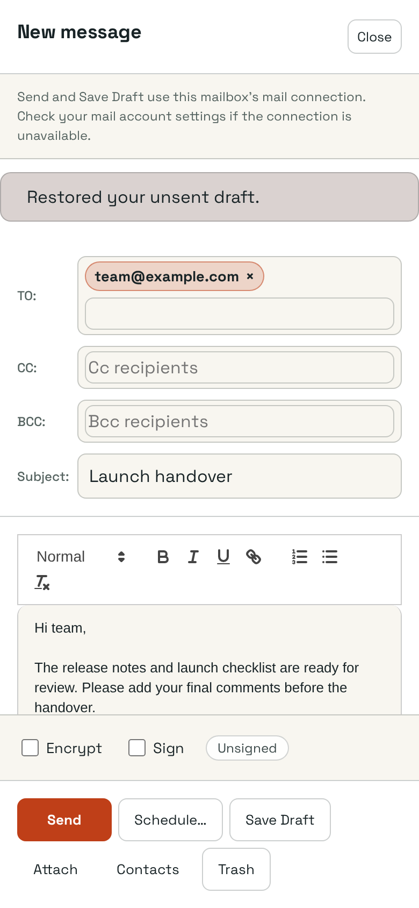
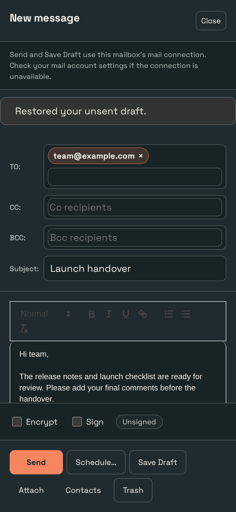

# KyPost interface polish

KyPost now has a quieter compose heading and writing area with visible security choices and a stable action footer. This implements the approved visual direction against the existing product; no mockup data or replacement application shell is shipped.

## Preserved

All 34 existing compose event handlers, recipient/From/mailbox choices, autosave/restore, attachments/contacts, encryption/signing/keyless fallback, send/schedule/draft/trash/close and confirmations.

No deployed configuration, accounts, credentials or stored content were changed. Authentication, API clients, persistence, backend logic, dependency manifests and migrations are unchanged. Product themes, palette choices and saved preference keys are retained; hash-pinned shared UI files are untouched. Existing React event-handler expressions were compared against the base revision and retained.

## Evidence

Captured 2026-10-19 from the built interface in T3's native browser, at 1440×1000 and 390×844 CSS pixels. PNG dimensions may be larger because of browser device scaling. The dark capture is a phone view. Capture conditions: Real disposable instance and local account with a required password change. An unsent example message was edited and restored through the normal autosave. No SMTP/IMAP account is connected to this fixture and no message was sent.

Before is the installation-campaign screenshot used for the approved proposal, with the recipient chip and instance error text covered by opaque redactions. After is this branch on disposable data using example.com recipients. Their content differs; these images compare presentation, not a live-data migration. The PR branch was rebuilt on main so its history contains only the redacted before image.

| Before | Implemented desktop |
| --- | --- |
|  |  |

| Implemented phone | Implemented phone, dark |
| --- | --- |
|  |  |

## Checked

`npm test`: 1155 tests passed. Production build passed. Typecheck, lint (0 errors; 18 existing warnings), 1,155 tests and production build passed. Native phone checks: no horizontal compose overflow, security choices visible above the footer, Schedule dialog opens/cancels, encryption still exposes the keyless fallback.

The inspected phone state had no document-width overflow. This is targeted interface verification, not an exhaustive accessibility or nine-product integration qualification. Repository-wide CI, container/PostgreSQL/real-runtime checks and autonomous review remain separate gates.

## Review

Review [frontend/src/components/ComposeWindow.tsx](frontend/src/components/ComposeWindow.tsx) for the product layout and preserved actions. Generated assets and screenshots can be skipped when reviewing behavior. Check the source layout and existing permission/confirmation boundaries before merging. No deployment or merge is included.
