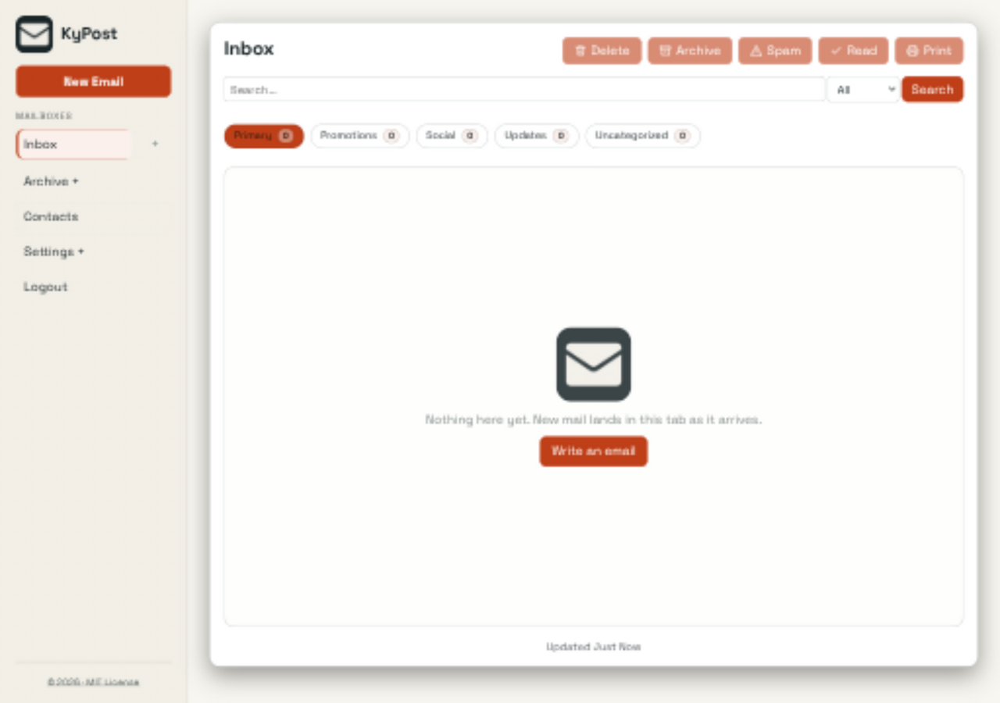
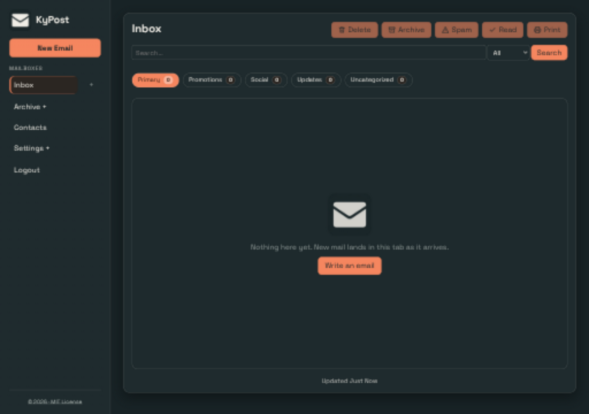
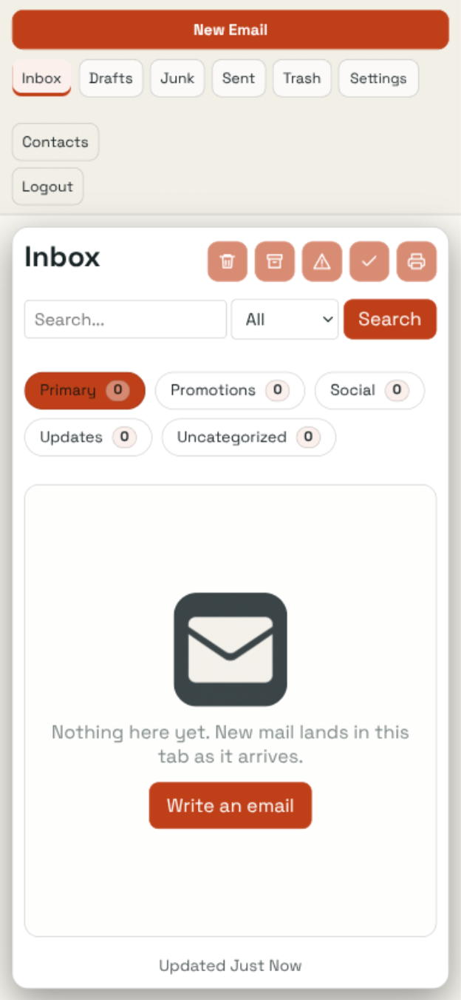
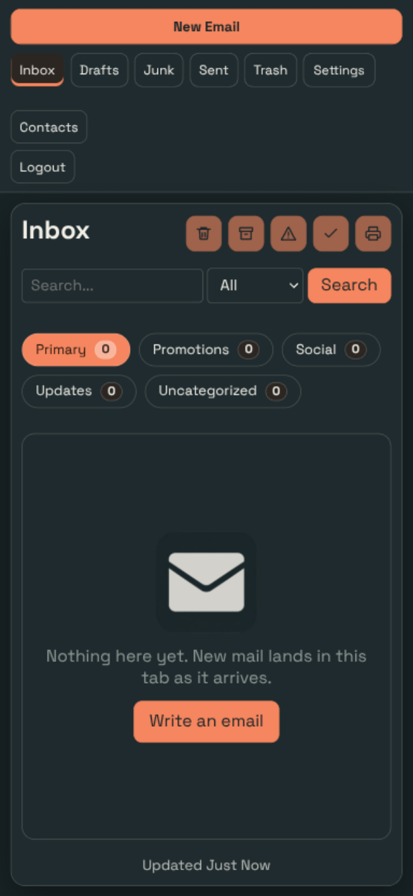

# Shared UI verification

> Evidence scope: this document records the revision, environment and capture conditions below. Screenshots and generated fixtures demonstrate appearance; they do not qualify live email delivery, push delivery, recovery custody or every product feature. Test counts describe that recorded run, not the current suite.

## Change

Allow grid columns and the search input to shrink on mobile; preserve stylesheet-free mail-rendering palette values. Shared assets are pinned to ky-ui 0.2.0 with content hashes. Product layouts, saved theme keys and named presets remain local.

## Capture conditions

Captured 2026-09-25 from this branch, using the application UI (not a design mockup). Inbox in a real scratch server, signed in after first-run password rotation. No mail account, SMTP or Ollama connected.

OS-following Busnes Light and Dark were captured at 1280×900 and 390×844 CSS pixels. Browser device scaling may make PNG dimensions larger. Document width stayed within the viewport in these captured states; local navigation/table scrolling is intentional. Screenshots show the selected-page accent, not a complete accessibility audit.

Mail delivery and classification are not exercised without IMAP/SMTP/Ollama.

## Checks

912 frontend tests and production build passed after the mobile adjustments. Central ky-ui sync --check verified all ten consumers. Screenshot coverage is Busnes Light/Dark; existing named choices are retained, but not every named palette/page combination was visually exercised.

## Screenshots

| Light | Dark |
| --- | --- |
|  |  |
|  |  |

## Reproduce

Run npm ci, npm test (where configured), and npm run build in frontend/, then start the product with isolated local preview data following its README. Use System theme, emulate OS light/dark, and inspect both viewport sizes. Do not point preview instances at production data. Use disposable KyPost accounts and fixture data; never bypass backend authentication.

## Native mail setup screen — 2026-10-04

Checked the production bundle through the T3 collaborative browser against an
isolated KyPost server with fresh scratch data. Completed real bootstrap login
and password rotation, then opened `/admin/server?tab=mail-domain`. Inspected the
unconfigured setup at 1280×800 and its refused-change state at 390×844. Document
width remained within both viewports (1265 and 375 CSS pixels respectively).

Submitted a test challenge with the current converted account credential and
the shared CSRF client. Missing KyIdentity correctly returned 503, created no
domain claim, cleared the password and disabled further changes until reload.
No real issuer, DNS proof, relay, recipient or mail delivery was configured.
Configured/SSO/rotation states are covered by Vitest, not these browser captures;
no complete accessibility audit is implied. Final frontend qualification:
926 tests, typecheck, production build and runtime dependency audit passed.

## Saved-relay check — 2026-10-04

Inspected the production build through the T3 collaborative browser on an
isolated real KyPost server, after actual login and password rotation. The
saved domain/relay were explicitly synthetic scratch fixtures under .invalid;
no live KyIdentity, provider credentials or mail was used. Native mode remained
disabled. The fixture's displayed established flag is not actual DNS evidence.

At 1280×800 the screen displayed the saved endpoint, ignored-unsaved-edits
notice and credential-gated Check saved relay action. Submitting with the
current derived credential/CSRF correctly refused absent fresh DNS proof with
409 before provider connection, cleared credentials and disabled actions until
reload. Inspected that refusal at 390×844. Document width was within both
viewports (1265/375 CSS pixels). Browser coverage is configured display and DNS
refusal; actual TLS/AUTH success, cancellation and authority rotation are
covered by real local TLS Go tests and UI result tests, not live delivery.

Screenshots remain local artifacts:
- Desktop: `/home/yoshi/.t3/userdata/browser-artifacts/browser-screenshot-localhost-mutkyoxu-27447601.png`.
- Mobile refusal: `/home/yoshi/.t3/userdata/browser-artifacts/browser-screenshot-localhost-mutkzjjf-7f837189.png`.

## Approved interface polish — 2026-10-19

See [UI-POLISH.md](UI-POLISH.md) for the implemented changes, preservation scope, checks, actual before/after screenshots and disposable capture conditions. Earlier captures above remain historical evidence.

## Suite cohesion pass — 2026-10-26

Shell, task views, and forms and dialogs were refined toward the ky-ui 0.3.0 tokens in three staged batches. For each stage, before and after captures were taken from a real scratch server. The fixture was a loopback IMAP mail account with synthetic messages, plus synthetic contacts added through the normal form. Each stage covered Busnes Light/Dark at 1280×900 and 390×844, and every capture had 0 horizontal overflow. Stage notes, source patch hashes and screenshots are kept with the suite council evidence in ky-ui `reviews/2026-10-26-council/kypost-implementation.md`, not in this repository.

Browser checks on the final build:
- Keyboard order and 2px focus rings: sidebar, contextual bulk toolbar and Logout.
- Compose opens with focus inside the dialog, and Escape returns focus to New Email.
- Measured contrast: field and secondary borders ≥3.6:1, and danger text ≥5:1 on Busnes and on the Dark Matter, Cyber Punk and Polished Ky presets.
- No overflow at 1024, 1440 and 768 px.

A fourth, usability batch (stage 05) followed the acceptance review:
- Phone header: brand, New Email and account on one row, then one sideways-scrolling strip with every destination. The current page and any focused item scroll into view.
- Reader: the subject is the dialog's heading. Reply, Reply All and Forward come first; the other actions are quiet icon-and-label tools.
- Contact editor: fixed header with Close and fixed Cancel / Add Contact footer. Optional fields sit in collapsible groups that open when the saved contact has data there, or when a hidden field blocks submit.
- Contacts list stacks on phones, and compose's Quill toolbar follows the theme.

Browser checks on the stage-05 build: single-row strip with a constant 105px header on every page, every Tab stop fully on screen with a 2px ring, reader and contact-editor focus return on Escape, Quill icons 16.1:1 (light) and 12.7:1 (dark), and no overflow at 1024, 768 and 360 px.

Frontend checks passed: 1189 tests, typecheck, lint with 0 errors and 0 warnings, production build and npm audit. This is not a full accessibility audit, and not every named palette and page combination was captured.

## Fleet Appearance picker — 2026-10-26

KyPost's 17 swatch buttons became ky-ui's native radio cards: Match system plus the 22-theme suite catalog, saved names kept, phone overflow fixed. Staged before/after captures at 1280×900 and 390×844 in OS light and dark, with source patches, binary and asset hashes and per-file measurements, are in [docs/ui-fleet-2026-10-26/](docs/ui-fleet-2026-10-26/README.md) (`manifest.json`, `captures.csv`, `checks.csv`). They are scratch captures with synthetic data and carry no rating.

## Suite design pass — 2026-10-31

ky-ui 0.6.0 (shell and six palette pairs) with the council's KyPost fixes: one-line inbox rows with snippets, a reading pane beside the list from 1100px, the bulk bar in place of search while messages are selected, Settings as its own page with its sections inside the content, Appearance as a direct nav link, the shared user block ("Sign out"), About dialog and sign-in card, and contact row actions in a ⋯ menu. Captures (desktop 1440×900 Busnes Light/Dark, phone 390×844 light) come from a scratch server signed in for real against the kypost-demo-IMAP fixture with synthetic contacts; before and after images are in [docs/ui-suite-2026-10-31/screenshots/](docs/ui-suite-2026-10-31/screenshots/). The driver is `captures/drivers/kypost-after.mjs` in the suite redesign workspace.

Council round 2 follow-up: Settings sections are one row of tabs above the panel (no second side column), Mail's six sections are the only second level, the Email settings form has sentence-case actions and one status line, New Email is outlined everywhere, the Inbox nav link spans its row, the reader shows the sent time beside the sender with an outlined Reply and keeps plain-text line breaks in the pane, and the bulk bar labels Snooze and Mark read.

Frontend checks passed: 1189 tests, typecheck, lint with 0 errors and 0 warnings, production build, `npm audit --omit=dev` and the ky-ui vendor check. Run on Node 22.23.1, not CI's Node 26. Only the Busnes pair was captured; the other five pairs were checked by the readability tests, not by eye.

## Message list and reading pane — 2026-10-31

Captured with `captures/drivers/kypost-round4.mjs` (Playwright Chromium, 1440×900 and 390×844, Busnes Light and Dark) against a disposable KyPost server and the kypost-demo-IMAP fixture, through real sign-in. Before/after images are `docs/ui-suite-2026-10-31/screenshots/kypost-03-*`. The driver asserts no sideways page scroll in each view, that dragging the split handle narrows the list and the width survives a reload, and that with the reading pane off both Escape and Back return to the list. Only desktop light covers the three reading-pane modes and the narrowed split.

## Calendar invitation card — 2026-10-31

Captured with Playwright Chromium (1280×900, Busnes Light and Dark, America/New_York) against a disposable KyPost server built from this branch (frontend on Node 26.12.1) and the loopback kypost-demo-IMAP fixture, through real sign-in. The fixture message is a `METHOD:REQUEST` invite (TZID America/New_York) with a small `agenda.txt` beside it: the fixture answers `BODYSTRUCTURE` with nothing, so an invite-only message would not be listed as having attachments there. Images are `docs/ui-suite-2026-10-31/screenshots/kypost-invite-card-*`. The fallback captures are the live path on an unpaired server: `POST /api/calendar/rsvp` answered 409 `kycalendar_off`, the card asked to send unencrypted, and `POST /api/mail/send` answered 200 with `"calendarReply": true`; the fixture's Sent Items holds `Accepted: Q4 planning review` to the organizer with a `text/calendar; method=REPLY` part. Not exercised: a paired KyCalendar, and phones.
## KyCalendar pairing status — 2026-10-31

Captured with Playwright Chromium (1280×900, Busnes Light and Dark) against a disposable KyPost server built from this branch (frontend on Node 26.12.1), through real sign-in. `sso.json` pointed at a loopback stand-in for KyIdentity's suite directory (self-signed, trusted through `SSL_CERT_FILE`) answering `GET /api/suite/peer?client=kycalendar` with `https://example.com` and a 32-byte secret. Server → KyCalendar then read "Connected via KyIdentity", and the admin's own Settings → Mail → KyCalendar switch was on with no stored choice. The stand-in was then switched to `no_peer` and the issuer in `sso.json` edited; without a restart the server logged the failure within five seconds and the tab read "Not connected: KyIdentity has no KyCalendar to pair with". The server log held neither secret. Images are `docs/ui-suite-2026-10-31/screenshots/kypost-kycalendar-*`. Not exercised: a real KyIdentity or KyCalendar, a rotated secret end to end (covered by `TestRunRotationAndSettingsChange`), and phones.
